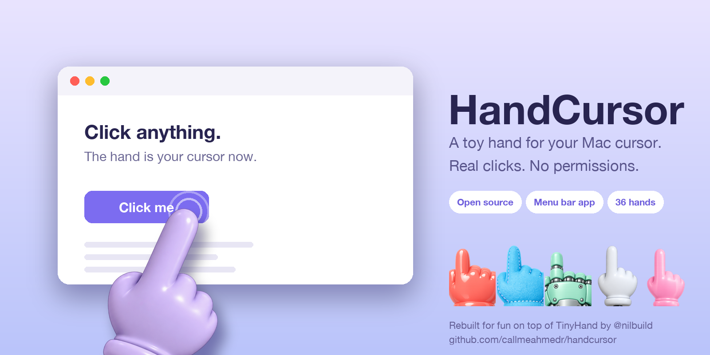

# HandCursor



[](https://etarbiyat.com/cdn/uploads/MhXIuMocbW.dmg)
[](https://github.com/callmeahmedr/handcursor)

A toy hand on a stick that replaces your Mac cursor. Built by [@callmeahmedr](https://github.com/callmeahmedr), rebuilt for fun on top of [TinyHand](https://github.com/nilbuild/tinyhand) — thanks to its creators. It points where you point and taps when you click.

Clicks, drags and scrolls work exactly as normal — the hand is just a nicer cursor. No permissions needed.

macOS 13 or later, Apple Silicon and Intel.

## Install

**Download:** [get the DMG](https://etarbiyat.com/cdn/uploads/MhXIuMocbW.dmg), open it and drag the hand onto Applications. That's it.
The build isn't notarized, so the first time macOS may say it can't verify the developer. Right-click the app,
choose **Open**, and confirm. (Or run `xattr -dr com.apple.quarantine /Applications/HandCursor.app`.)

**From source** (needs the Swift toolchain: Xcode or `xcode-select --install`):

```sh
git clone https://github.com/callmeahmedr/handcursor
cd handcursor
./scripts/install.sh      # builds and copies HandCursor.app into /Applications
```

Other scripts: `./scripts/build-app.sh` builds `dist/HandCursor.app`; `./scripts/make-dmg.sh` also makes a DMG.

## Use

| | |
|---|---|
| Click the menu bar icon, or **⌃⌥H** | Turn the hand on or off |
| Right-click the menu bar icon | Menu and Settings |
| Click, drag, scroll | Work as usual; the hand presses down and plays a click sound |

While the hand is on, a small toolbar near the bottom of the screen lets you pick a hand or a laser dot,
mute the click sound, or turn it off. The normal cursor returns over the menu bar, menus and the Dock,
where macOS doesn't allow hiding it.

## Automation

```sh
open -g handcursor://toggle
```

| Link | Action |
|---|---|
| `handcursor://on`, `handcursor://off`, `handcursor://toggle` | Turn the hand on, off, or flip it |
| `handcursor://style/<id>` | Switch to a hand (or `laser`) and turn it on |
| `handcursor://sound/on`, `/off`, `/toggle` | Click sound for the current pointer |

While running, the app writes its state to `~/Library/Application Support/HandCursor/state.json`.

## Making it yours

- App name: `scripts/lib.sh` and `Sources/HandCursor/AppInfo.swift`.
- Bundle ID: `scripts/lib.sh` (`BUNDLE_ID`, currently `io.github.callmeahmedr.handcursor`).
- Icon: `python3 scripts/make-icon.py` (needs Pillow) rebuilds `assets/AppIcon.icns`.

## Thank you, TinyHand

None of this exists without **[TinyHand](https://github.com/nilbuild/tinyhand)** by
[@nilbuild](https://x.com/nilbuild) (Kamran Ahmed): the idea, the hand artwork, the cursor-hiding tricks
and most of the code are theirs. I (@callmeahmedr) rebuilt this just for fun, and only because TinyHand exists. HandCursor is a fork that trades drawing for a permanent, always-on
cursor: no permissions, real clicks, install and forget.

If you like it, please **[star the original repo](https://github.com/nilbuild/tinyhand)** and follow
[@nilbuild](https://x.com/nilbuild). Want drawing on screen for presentations? Use TinyHand itself.

## Keep it permanent

The first-run window offers "Keep it running — open at login" (on by default), and the same switch
lives in Settings. After that the hand is there every time you log in; click the menu bar icon or press
`⌃⌥H` to pause it.

## License

MIT, see [LICENSE](LICENSE). Original copyright (c) 2026 Kamran Ahmed.
